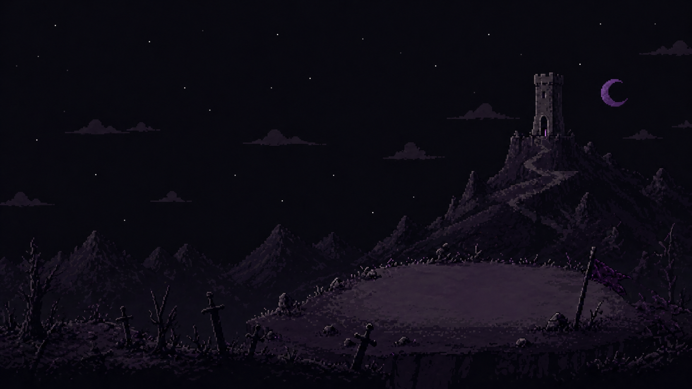

# Ravager: Rise of the Beast

Ravager is a top-down 2D survival roguelite built in Unity and C#. Survive enemy waves, earn experience, and discover mutations and skills that change each run. The game source includes a wave manager, bosses, player characters, world systems, and progression logic.

## What is in this repository

- `gameplay-scripts/` — selected Unity C# scripts for combat, enemies, bosses, skills, mutations, waves, characters, and world systems.
- `art/` — original game icon and menu background from the project.
- `Unity-version.txt` — the Unity editor version used by the source project.

This is a public portfolio showcase of gameplay code, not a standalone Unity project. The full development project also contains scenes, third-party packages, service configuration, and a private backend. Those parts are kept in a separate private repository. The scripts here are provided for reading and may depend on other code in that project.
